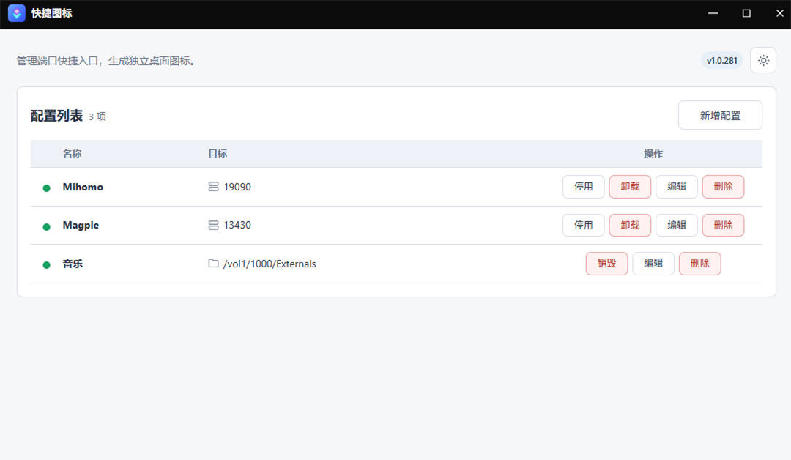
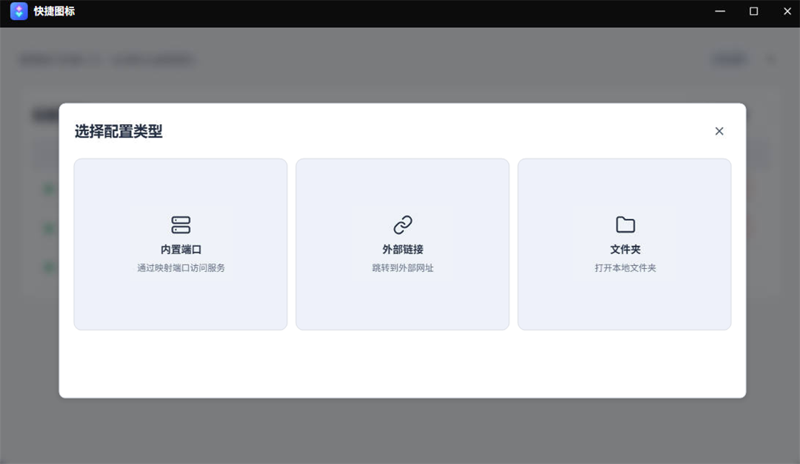
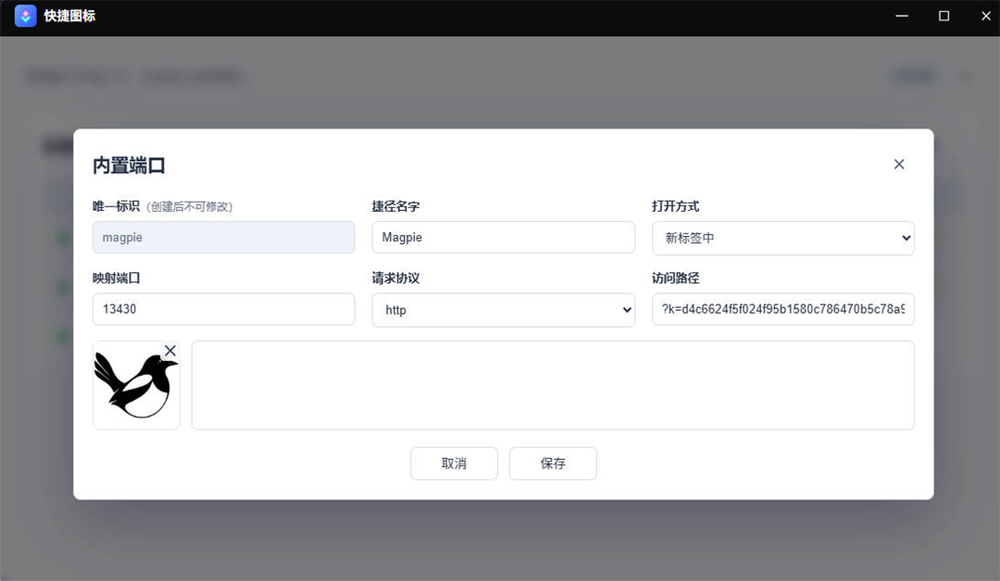
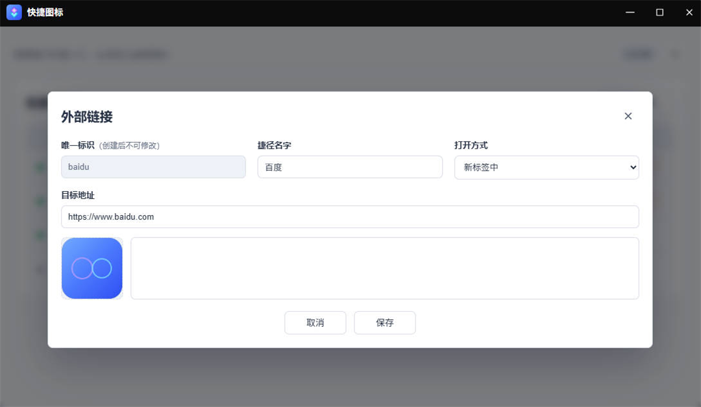
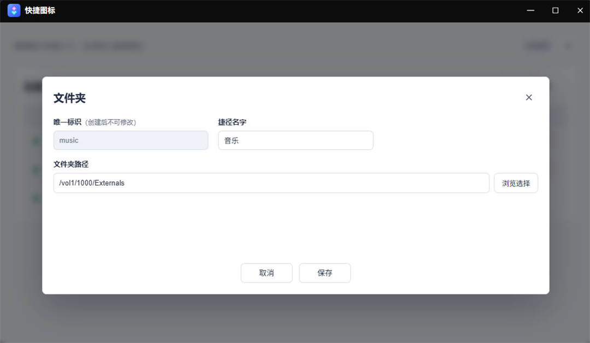

# 快捷图标

飞牛 fnOS 原生应用：把局域网服务的端口/路径、或 NAS 上的文件夹，变成飞牛桌面上的**原生快捷图标**，双击直达，不用每次翻文件管理器或记地址。

[](https://github.com/chens-hi/shortcuts/releases/latest)
[](LICENSE)


> 一个列表管理三类快捷入口，部署状态与运行状态一眼可见。

| 配置列表 | 新增配置 |
| :---: | :---: |
|  |  |

## 三种快捷入口

| 内置端口 | 外部链接 | 文件夹 |
| :---: | :---: | :---: |
|  |  |  |

- **内置端口**：填映射端口、协议、路径，生成独立子应用 `<主应用名>-<唯一标识>`，打开时访问 `协议://当前地址:端口/路径`。
- **外部链接**：填目标地址，生成子应用，启动时 302 跳转。
- **文件夹**：不安装子应用，直接在桌面创建原生文件夹项，双击由桌面打开文件管理器。

打开方式有两档：**桌面内嵌**（作为应用窗口打开）和**新标签中**（在浏览器新标签页打开）。

| 字段 | 约束 |
| --- | --- |
| 唯一标识 | 2–12 位，以小写字母开头，只含小写字母、数字和连字符；决定子应用名，创建后不可修改 |
| 捷径名字 | 最多 12 个字符，显示在桌面图标下方 |
| 文件夹路径 | NAS 上的绝对路径（如 `/vol1/1000/照片`），可浏览或手动输入；保存时 root 校验真实存在且是目录 |

保存后点「部署」（端口/链接）或「创建」（文件夹）才会生效；之后改配置，状态圆点变黄（待更新），再点一次「更新」即可。

## 安装

要求 fnOS **1.2.0 及以上**、架构 `amd64` / `arm64`（「系统设置 → 关于」可查）、**管理员**账号（应用仅对管理员可见）。

从 [Releases](https://github.com/chens-hi/shortcuts/releases/latest) 下载对应架构的 `.fpk` → fnOS「应用中心 → 手动安装」→ 桌面出现「快捷图标」，点开即可添加配置。

## 注意事项

- **文件夹快捷方式必须在飞牛桌面里打开「快捷图标」才能创建**。在独立浏览器标签页里打开应用页时，页面拿不到桌面宿主接口，会提示「请在飞牛桌面中打开『快捷图标』」——这不是故障。
- 创建或销毁桌面项后，图标会立即增减，**不需要手动刷新**。这条机制依赖桌面未公开的事件约定，失效时会退化为「按 F5 刷新」，功能不受影响。
- 文件夹类型不使用自定义图标，桌面项统一显示系统文件夹图标。
- 删除条目、卸载应用都**不会删除**文件夹里的任何内容，只会移除快捷方式与子应用。
- 端口/链接类型生成的是独立子应用，会出现在应用中心里。移除条目时会尽力卸载它；如果在应用中心手动卸载过子应用，列表会显示「待更新」之类的不一致状态，重新部署即可。

## 常见问题

- **桌面没有出现图标？** 先确认列表状态是「已创建」；若是「桌面项丢失」，点「重建」。
- **为什么浏览器里打开应用创建不了桌面项？** 桌面项由飞牛桌面宿主接口创建，只有桌面内的应用窗口才有这个通道。请在桌面上双击「快捷图标」打开。
- **升级或重装应用后，配置和桌面项还在吗？** 配置保存在数据目录，升级不动它；桌面项属于当前用户的桌面，也不会随应用升级被删除。
- **日志在哪里？** 数据与日志都在 `/usr/local/apps/@appdata/shortcuts/`：`log/` 下按天保存（保留 7 天），`shortcuts.json` 是配置，`build/` 是子应用构建缓存。

## 开发

仓库使用 Go 标准库（无第三方依赖）+ 原生 JS 前端，前端页面在 `shortcuts/app/ui/www/`。

| 目录 | 内容 |
| --- | --- |
| `cmd/` | Go 主入口，`server` / `agent` / `cleanup` 三种运行模式 |
| `internal/` | 领域模型、仓储、Provider、日志、部署编排、HTTP API、Unix Socket 特权代理 |
| `shortcuts/` | `.fpk` 应用包结构：manifest、生命周期脚本、配置、向导、UI、子应用模板 |
| `icons/` | 图标源文件与 `make-icons.js` 生成器 |
| `tools/` | 版本同步与递增、打包、校验脚本，以及随仓库分发的 `fnpack` |
| `docs/` | 开发说明与设计文档 |

### 构建

```bash
mkdir -p shortcuts/app/bin
GOOS=linux GOARCH=amd64 CGO_ENABLED=0 go build -o shortcuts/app/bin/fnrt ./cmd
```

产物必须落在 `shortcuts/app/bin/fnrt`：包内 `app/` 会映射为安装目录 `target/`，`shortcuts/cmd/main` 从 `$APP_DIR/bin/fnrt` 启动进程。

### 测试与校验

```bash
go test ./...
go vet ./...
```

```powershell
.\tools\validate-ui.ps1
.\tools\check-encoding.ps1
```

`validate-ui.ps1` 会对 `index.html` 内联脚本与 `app.js`、`shortcuts-i18n.js` 跑 `node --check`，并检查两类常见损坏：模板字符串插值丢失美元符号（PowerShell 双引号转义把 `${expr}` 变成 `{expr}`，JS 会原样打印大括号而不求值），以及 `querySelector` 里的反引号。`check-encoding.ps1` 保证所有文本文件是 UTF-8 无 BOM。

### 打包

`tools/` 里带了一份 `fnpack`（Windows 与 Linux 各一），脚本按「显式 `-FnpackPath` → `tools\` 内同名文件 → `PATH`」的顺序查找：

```powershell
.\tools\package-shortcuts.ps1 -Arch amd64,arm64
.\tools\check-package.ps1 -PackagePath dist/shortcuts-<version>-linux-amd64.fpk
```

产物为 `dist/shortcuts-<version>-linux-<arch>.fpk`；打包前会删除 `dist/` 里不匹配当前版本的其他包（含手工放的旧版本）。

> **打包不会升级版本号。** `package-shortcuts.ps1` 只按 `shortcuts/manifest` 里现有的 `version=` 出包；`bump-version.ps1` 才递增并同步 UI/README，先 bump 再打包，否则会重复产出同一个旧版本。

当前测试包版本：`1.0.287`。

### 发布

`push` 到 `main` 且改动包含 `shortcuts/manifest` 会触发 GitHub Actions（`.github/workflows/build.yml`，`ubuntu-latest`），也可手动 `workflow_dispatch`。流程为：同步版本并校验 → 双架构打包（amd64+arm64）→ `check-package` 校验 → 发布。

Release 固定挂在单个 `latest` tag 上：每次构建清空该 Release 旧资产、上传新 `.fpk`、把 `latest` tag 强制挪到当前提交，并删除其余历史 Release、游离 tag 与旧运行记录。Release 描述取 `manifest` 的 `desc`。

### 版本规则

`shortcuts/manifest` 是版本唯一来源。改完代码跑一次 `bump-version.ps1`：自动把最低位递增（如 `1.0.266` → `1.0.267`），并同步 UI 徽标、i18n 常量与 README 版本行。需要跳到指定版本时用 `-Version`（如 `1.1.0`）：

```powershell
.\tools\bump-version.ps1
.\tools\bump-version.ps1 -Version 1.1.0
```

### 图标

```bash
node icons/make-icons.js
```

生成后自动拷贝到 `shortcuts/`（包图标 `ICON.PNG`、`ICON_256.PNG`）、`shortcuts/app/icons/`（子应用默认图标）与 `shortcuts/app/ui/images/`（桌面图标）。

### 架构要点

- Entry 的公共字段与类型专属 Config 分离，新增类型不必改主表结构。
- 每种类型实现一个 `EntryProvider`，负责校验、子应用目录内容与展示信息。
- HTTP handler 只做请求转换，业务逻辑在 service 层；部署、启停、卸载由 `DeployService` 统一编排。
- 需要 root 的系统命令（`appcenter-cli` 等）只经 `AgentServer` 白名单执行，server 进程按 `TRIM_USERNAME` 降权运行。
- 文件夹快捷方式的目标路径存在性也由 root agent 判定（`stat-dir` 动作）：降权 server 读不到 `/vol1` 共享目录，本地 `os.Stat` 会误报；`stat-dir` 不占 agent 的 CLI 并发槽、单次上限 10s，避免拖慢保存。
- 关键动作统一写日志：启动、配置保存、子应用构建、appcenter 命令、部署与启停结果。

## 文档

每种入口类型一份开发说明，含实现链路与注意事项：

- [端口映射快捷方式开发说明](docs/internal-port.md)
- [外部链接快捷方式开发说明](docs/external-url.md)
- [文件夹快捷方式开发说明](docs/folder.md)

## 许可

[MIT](LICENSE)。

本项目是第三方应用，与飞牛官方无关。文件夹快捷方式与桌面即时刷新依赖桌面未公开的内部接口，fnOS 升级后可能失效；请自行评估使用风险。
